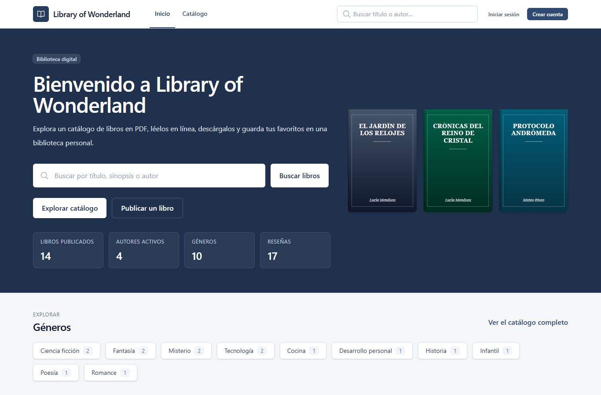
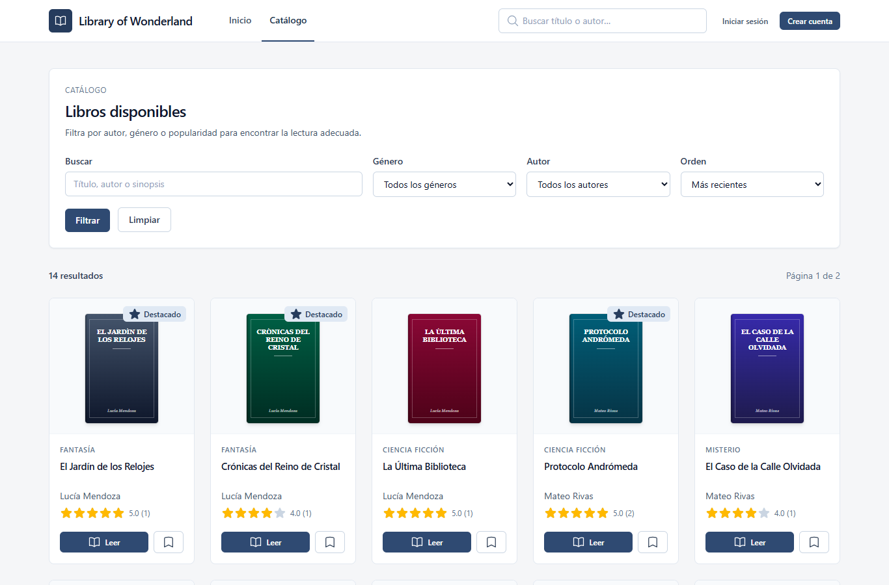
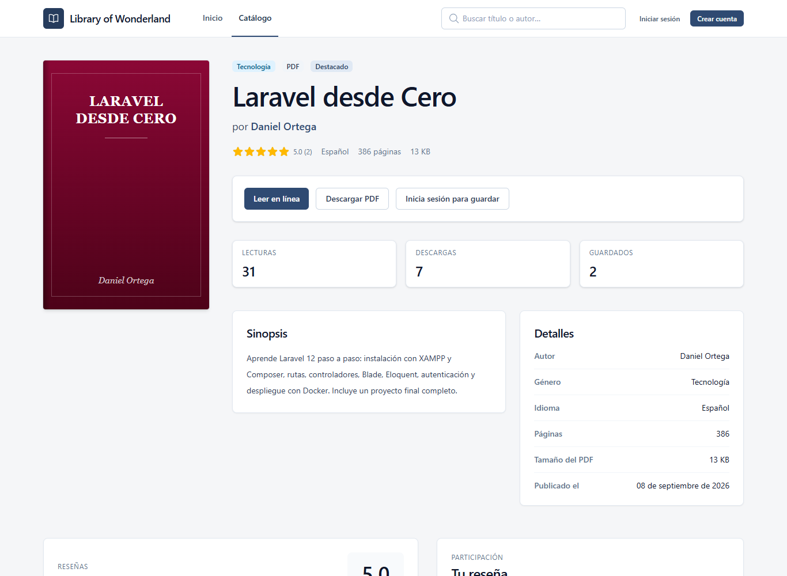
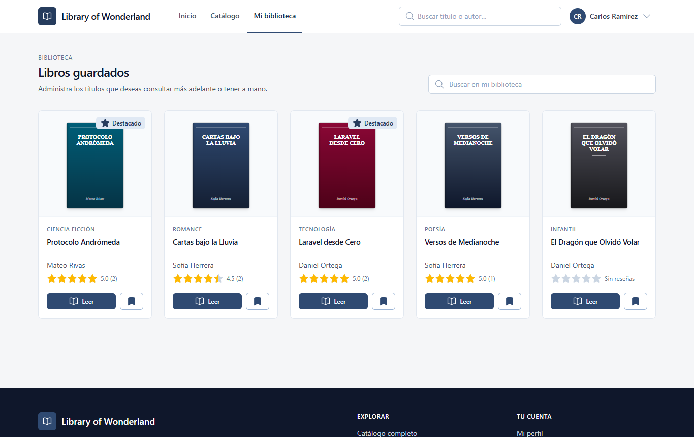
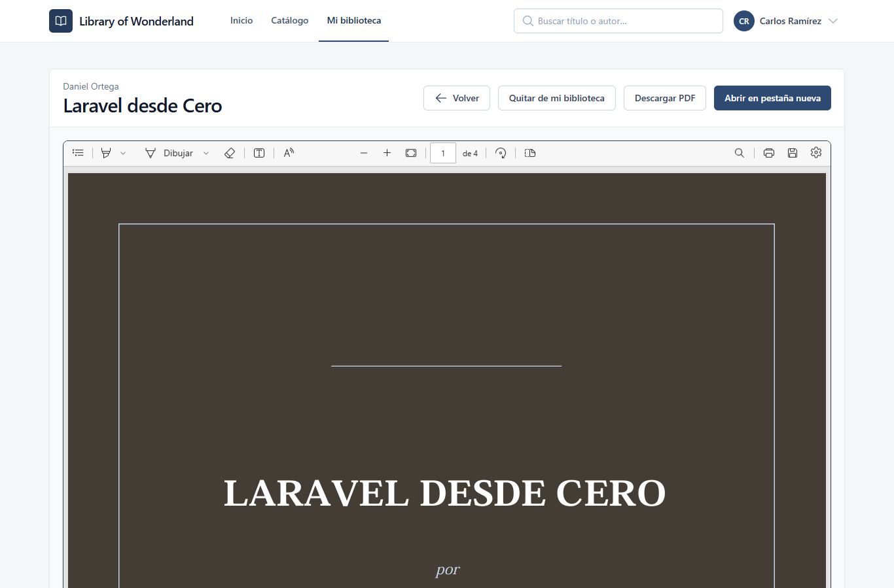
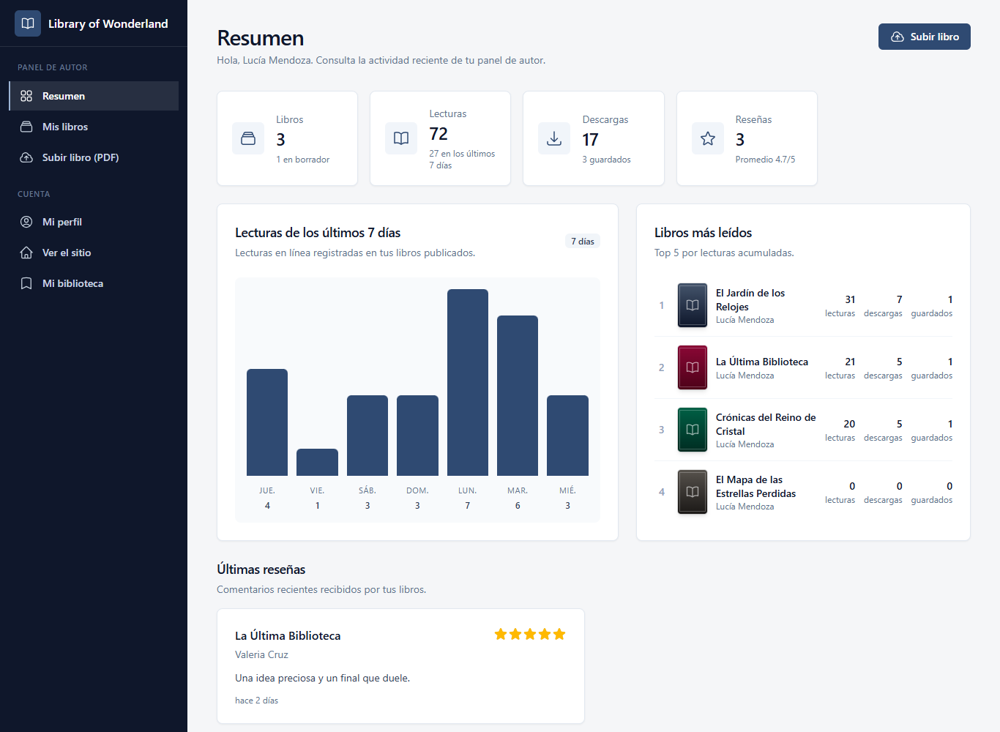
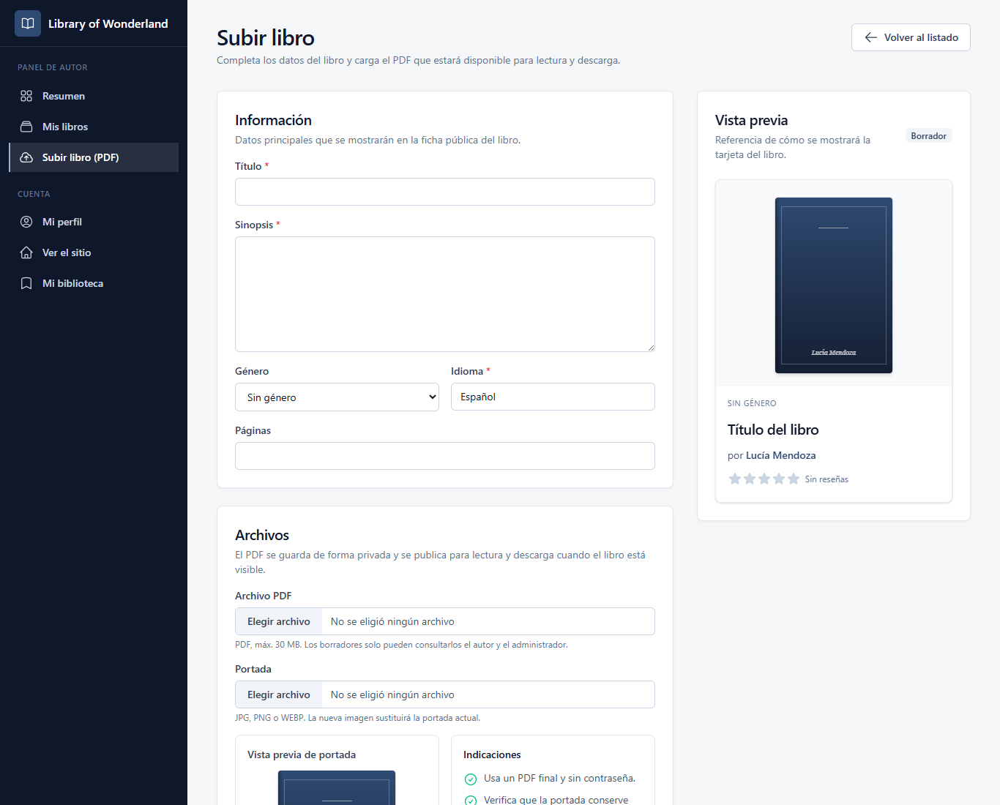
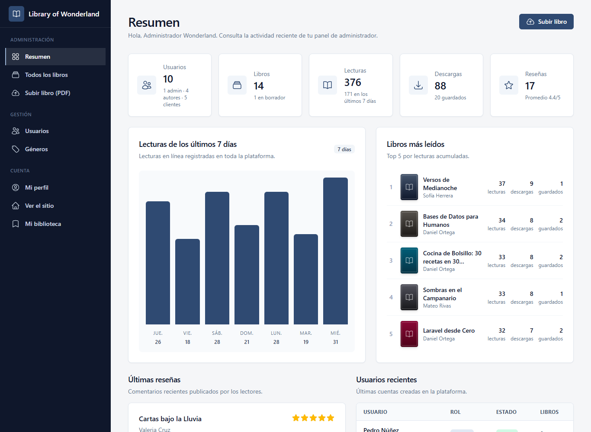
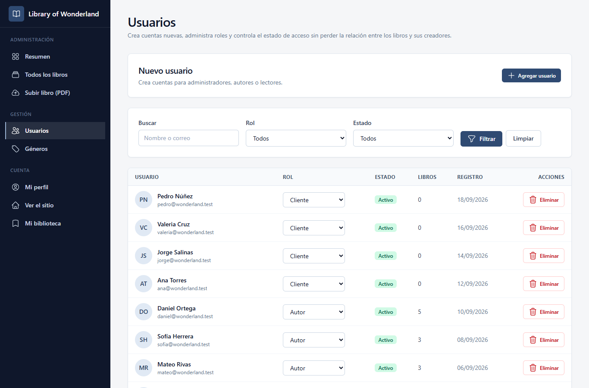
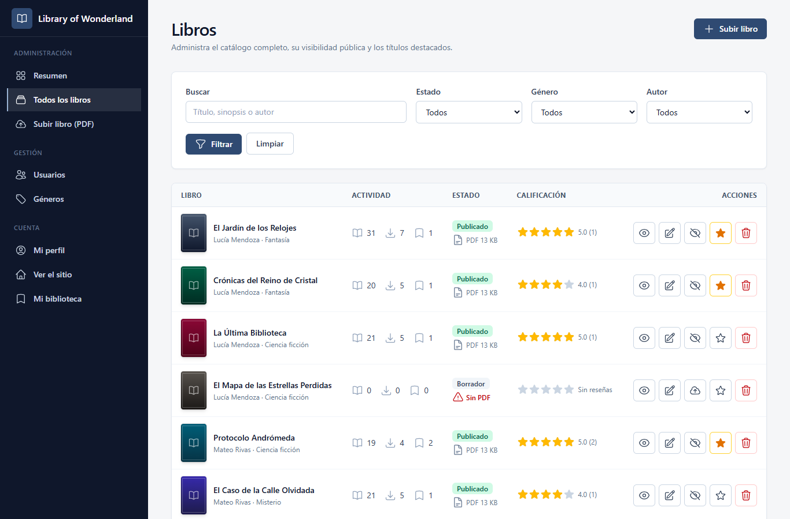

# Library of Wonderland

Biblioteca digital **gratuita** hecha con **Laravel 12**, **Tailwind CSS 4**, **Alpine.js** y **MySQL/MariaDB o PostgreSQL**.
Los **autores** publican sus libros en **PDF** (con portada), cualquiera puede **leerlos en línea o descargarlos**, y quien crea
una cuenta puede **guardarlos en su biblioteca**, dejar **reseñas**. Un **administrador** gestiona libros, usuarios y géneros.

Es la versión funcional (con backend y base de datos) del prototipo Angular
[Aplicaciones-Web-Escalables---WCES](https://github.com/Shadox259/Aplicaciones-Web-Escalables---WCES):
mantiene sus pantallas (inicio, catálogo, biblioteca, lector, login, registro, admin y perfil) y agrega todo lo que allí era solo maqueta.

## Capturas

| | |
|---|---|
|  **Inicio** |  **Catálogo con filtros** |
|  **Detalle, reseñas y autor** |  **Mi biblioteca (libros guardados)** |
|  **Lector de PDF en línea** |  **Panel de autor** |
|  **Subir libro (PDF + portada)** |  **Panel de administrador** |
|  **Administración de usuarios** |  **Administración de libros** |

## Qué puede hacer cada rol

| | Invitado | Cliente | Autor (creador de libros) | Administrador |
|---|:---:|:---:|:---:|:---:|
| Ver inicio, catálogo, detalle de libro y perfil público del autor | ✅ | ✅ | ✅ | ✅ |
| **Leer el PDF en línea y descargarlo** (libros publicados) | ✅ | ✅ | ✅ | ✅ (también borradores) |
| Crear cuenta / iniciar sesión | ✅ | | | |
| **Guardar libros en "Mi biblioteca"** | | ✅ | ✅ | ✅ |
| Escribir reseñas (1 a 5 estrellas) | | ✅ | ✅ (no en sus libros) | ✅ |
| **Subir libros en PDF + portada**, editar, publicar/ocultar, borrar | | | ✅ (solo los suyos) | ✅ (de cualquier autor) |
| Ver estadísticas de lecturas, descargas y guardados | | | ✅ (las suyas) | ✅ (todas) |
| Destacar libros en el inicio | | | | ✅ |
| **Agregar usuarios**, cambiar su rol, desactivar/reactivar cuentas | | | | ✅ |
| Gestionar géneros | | | | ✅ |

**Eliminar un usuario lo desactiva** (no se borra la fila): un libro no puede quedar sin creador. Sus libros siguen visibles con su nombre y un administrador puede reactivar la cuenta.

### Cuentas de demostración

| Rol | Correo | Contraseña |
|---|---|---|
| Administrador | `admin@wonderland.test` | `admin123` |
| Autor | `autor@wonderland.test` | `autor123` |
| Cliente | `cliente@wonderland.test` | `cliente123` |

Hay además otros autores y clientes de ejemplo, 15 libros con PDF, reseñas y actividad para que los paneles tengan datos.
**Cambia estas contraseñas (o crea tu propio administrador, ver abajo) antes de publicar el sitio en Internet.**

---

## Ejecutar con Docker (recomendado)

Todo corre en contenedores: la aplicación (PHP 8.2.35 + Apache) y la base de datos (MariaDB). **No hace falta instalar PHP, Composer, XAMPP ni nada más** — solo Docker Desktop.

```bash
docker compose up -d        # descarga la imagen y arranca todo
```

Abre **<http://localhost:8080>**. La primera vez tarda un poco (descarga + crea la base de datos y carga los datos de demostración).
Con solo el archivo [`docker-compose.yml`](docker-compose.yml) en una carpeta ya funciona: no necesitas clonar el repositorio.

| Servicio | Dirección | Notas |
|---|---|---|
| Aplicación | <http://localhost:8080> | cuentas de demostración de arriba |
| phpMyAdmin (opcional) | <http://localhost:8081> | `docker compose --profile tools up -d` · usuario `root` / contraseña `root` |

Los datos se guardan en **volúmenes** de Docker (base de datos, PDF, portadas), así que sobreviven a reinicios y actualizaciones de la imagen.

```bash
docker compose logs -f app                                     # ver el arranque / errores
docker compose exec app php artisan wonderland:admin yo@correo.com MiClave123   # crear tu propio administrador
docker compose exec app php artisan wonderland:install --fresh # recrear la base con datos de demostración
docker compose pull && docker compose up -d                    # actualizar a la última imagen
docker compose down                                            # detener (los datos se conservan)
docker compose down -v                                         # detener y BORRAR todos los datos
```

Variables opcionales (archivo `.env` junto al `docker-compose.yml`): `APP_PORT` (8080), `DB_PASSWORD`, `WONDERLAND_SEED=false` (no cargar datos de demostración),
`WONDERLAND_SHOW_DEMO=false` (ocultar las cuentas de demostración en el login), `APP_DEBUG`, `APP_KEY`.

### De dónde sale la imagen (y cómo publicar la tuya)

El repositorio incluye el flujo [`.github/workflows/docker-publish.yml`](.github/workflows/docker-publish.yml): cada vez que subes código a `main`,
**GitHub construye la imagen y la publica en `ghcr.io/<tu-usuario>/library-of-wonderland`** (amd64 y arm64), sin secretos ni configuración extra.

1. Sube el proyecto a tu repositorio de GitHub (rama `main`).
2. Pestaña **Actions** → espera a que termine *Publicar imagen Docker*.
3. La imagen queda **pública** por sí sola cuando el repositorio es público (hereda su visibilidad). Si tu repositorio es privado, o `docker compose pull` dice `unauthorized`: tu perfil → *Packages* → `library-of-wonderland` → *Package settings* → *Change visibility* → **Public**.
4. La imagen por defecto es `ghcr.io/jesusregil/library-of-wonderland`: si tu usuario de GitHub es otro, cambia la línea `image:` de `docker-compose.yml` (o define `WONDERLAND_IMAGE=ghcr.io/<tu-usuario>/library-of-wonderland:latest`).

¿Prefieres construirla tú? `docker compose -f docker-compose.yml -f docker-compose.build.yml up -d --build`.

**Computadoras sin acceso a Internet / a Docker Hub** (por ejemplo, redes de empresa o escuela): en una máquina con acceso ejecuta
`docker compose pull && docker save -o wonderland.tar ghcr.io/jesusregil/library-of-wonderland:latest mariadb:10.11` y en la otra `docker load -i wonderland.tar && docker compose up -d`.

### Con PostgreSQL en lugar de MariaDB

```bash
docker compose -f docker-compose.postgres.yml up -d      # misma aplicación, base PostgreSQL 16
```

(No ejecutes a la vez los dos archivos: usan el mismo puerto 8080.) Sin Docker: instala la extensión `pdo_pgsql`, pon `DB_CONNECTION=pgsql` y los datos de conexión en `.env` y ejecuta `php artisan wonderland:install`.

---

## Ver la página sin instalar nada (vista rápida)

Doble clic en **`ver-en-esta-pc.bat`**. Usa el PHP portátil de la carpeta `_php` (si existe) o el de XAMPP, y una base **SQLite** de demostración:
**no necesita MySQL, Docker, XAMPP ni Composer**. Abre el navegador solo en `http://127.0.0.1:8000`. Es ideal para enseñar el proyecto.

## Instalación en XAMPP (alternativa)

Necesitas **XAMPP con PHP 8.2 o superior** (elige la versión 8.2.x en <https://www.apachefriends.org>). Usa **8.2.35 o posterior** (o 8.3.36+ / 8.4.27+ / 8.5.12+): las anteriores tienen las vulnerabilidades críticas CVE-2026-109618 y CVE-2026-109619.

1. Copia la carpeta a `C:\xampp\htdocs\library-of-wonderland`.
2. En el Panel de Control de XAMPP pulsa **Start** en **Apache** y en **MySQL**.
3. Doble clic en **`instalar-xampp.bat`**: detecta PHP, instala dependencias si faltan (`composer install`), crea `.env`, **crea la base de datos**, las tablas y los datos de demostración.
4. Abre **<http://localhost/library-of-wonderland/public>**.

<details>
<summary>Lo mismo, a mano (terminal en la carpeta del proyecto)</summary>

```bat
composer install
copy .env.example .env
php artisan key:generate
php artisan wonderland:install
```

`php artisan wonderland:install` es idempotente: crea la base si no existe, migra y solo carga los datos de demostración si la base está vacía.
Opciones: `--fresh` (borra y recrea todo), `--no-seed` (sin datos de demostración). Crea tu administrador con `php artisan wonderland:admin correo clave`.
</details>

Valores por defecto de XAMPP (ya puestos en `.env.example`): servidor `127.0.0.1`, puerto `3306`, usuario `root`, **sin contraseña**, base `library_of_wonderland`. Ver tablas: <http://localhost/phpmyadmin>.
Otros `.bat`: `iniciar-servidor.bat` (sin Apache, con MySQL), `reiniciar-datos.bat` (⚠ borra la base).

---

## Estructura del proyecto

```
app/
  Http/Controllers/          Home, Catalog, Book, Author, Auth, Library, Reader, Profile, Review
  Http/Controllers/Panel/    Dashboard, Book, User, Genre (admin y autor)
  Http/Controllers/Api/      API JSON de solo lectura
  Http/Middleware/           EnsureRole (role:admin,autor), EnsureAccountIsActive
  Models/                    User, Book, BookRead, Genre, Review
  Policies/BookPolicy.php    quién puede editar (manage) y leer (read) un libro
  Services/BookFiles.php     guarda/borra PDFs (privados) y portadas (públicas)
  Support/SimplePdf.php      generador de PDFs de demostración (sin librerías)
  Console/Commands/          wonderland:install · wonderland:admin
database/migrations|factories|seeders      esquema, datos de prueba y de demostración
resources/views/           layouts, components (x-book-card, x-book-cover, x-stars, x-field, x-icon), store, auth, panel
resources/css/app.css      Tailwind 4 + sistema de diseño  →  public/css/app.css (ya compilado)
routes/web.php | api.php   todas las rutas
Dockerfile · docker-compose*.yml · docker/   imagen y entorno con contenedores
tests/                     pruebas automáticas (PHPUnit)
```

### Base de datos

```
users ──< books >── genres          users: name, email, password, role (admin|autor|cliente), bio, is_active
  │         │  └──< reviews         books: user_id (creador), genre_id, title, slug, synopsis, cover_path,
  │         │                              pdf_path, pdf_size, status (draft|published), is_featured
  ├──< book_user >───┘              book_user: "Mi biblioteca" (libros guardados por el usuario)
  └──< book_reads >──┘              book_reads: lecturas y descargas (estadísticas del panel)
```

### ¿Cómo se guardan los PDF?

- Cada libro guarda en la base de datos la **ruta, el nombre original y el tamaño** de su PDF; el archivo vive en `storage/app/private/books/` (fuera de `public/`).
- Se entrega únicamente a través de `ReaderController`: libros **publicados** para cualquiera; **borradores** solo para su autor y los administradores (404 para los demás).
- Las **portadas** (jpg/png/webp, máx. 4 MB) se guardan en `public/uploads/covers/`. Si un libro no tiene portada, se genera una automáticamente.
- Límite de PDF: **30 MB** (`config/wonderland.php`). XAMPP permite 40 MB por defecto; en Docker el límite de PHP ya está ajustado.

---

## Del prototipo Angular a Laravel

| Vista Angular | Ruta Laravel | Qué cambió |
|---|---|---|
| `home` | `/` | destacados, novedades, más leídos y mejor valorados reales desde la BD |
| `catalog` | `/catalogo` | el filtro ahora sí filtra (texto, género, orden) y pagina |
| `library` | `/mi-biblioteca` | libros que el usuario guardó |
| `reader` | `/leer/{libro}` | lector de **PDF** real |
| `login` / `register` | `/login`, `/registro` | autenticación real con sesiones, roles y validación |
| `admin` | `/panel` | panel de **administrador** y de **autor** (CRUD de libros con PDF y portada, usuarios, géneros) |
| `profile` | `/perfil` | editar datos, cambiar contraseña y desactivar la cuenta |

## API JSON (solo lectura)

Útil para conectar el frontend Angular u otra app. Devuelve los **mismos campos** que usaba el prototipo (`id, title, author, genre, cover_image`) y algunos más, incluida la URL del PDF.

```bash
curl "http://localhost:8080/api/v1/libros?genero=fantasia&orden=populares&por_pagina=5"
curl  http://localhost:8080/api/v1/libros/el-jardin-de-los-relojes
curl  http://localhost:8080/api/v1/generos
```

| Parámetro de `/api/v1/libros` | Valores |
|---|---|
| `q` | texto a buscar en título, sinopsis o autor |
| `genero` | slug del género (`fantasia`, `ciencia-ficcion`…) |
| `orden` | `recientes` (por defecto), `valorados`, `populares` (más leídos), `titulo` |
| `por_pagina` | 1 a 50 (por defecto 12) |

Ejemplo desde Angular (reemplaza los arreglos escritos a mano); el CORS ya está habilitado para `/api/*`:

```ts
this.http.get<{ data: Book[] }>('http://localhost:8080/api/v1/libros')
  .subscribe(res => this.allBooks = res.data);
```

---

## Estilos (Tailwind CSS)

El CSS ya viene compilado en `public/css/app.css`: **no necesitas Node para usar el proyecto**. Si cambias clases en las vistas o en `resources/css/app.css`:

```bash
npm install
npm run css          # compila una vez   (npm run css:watch para recompilar al guardar)
```

## Pruebas automáticas

```bash
php artisan test          # o: composer test
```

Usan SQLite en memoria (nunca tocan tu base de datos) y cubren autenticación por rol, permisos, catálogo, biblioteca, lector de PDF, reseñas, perfil, panel de autor/administrador, subida de archivos, usuarios, API, seeders y el instalador. El repositorio incluye CI en GitHub Actions.

## Problemas frecuentes

| Síntoma | Solución |
|---|---|
| Docker no descarga las imágenes (`context deadline exceeded`) | Sin conexión directa a Docker Hub/GHCR (proxy de la escuela o empresa): configura el proxy en Docker Desktop → Settings → Resources → Proxies, o usa `docker save`/`docker load` (ver arriba). |
| `unauthorized` al hacer `docker compose pull` | La imagen en GHCR sigue privada: ponla en **Public** (ver "De dónde sale la imagen"). |
| `No se pudo conectar a MySQL` (XAMPP) | Enciende **MySQL** en el Panel de Control de XAMPP. Revisa `DB_*` en `.env`. |
| `Your PHP version ... does not satisfy` | Necesitas PHP **8.2+**. Instala la versión de XAMPP con PHP 8.2.x. |
| Página en blanco o error 500 | Mira `storage/logs/laravel.log` (Docker: `docker compose logs app`). Con `APP_DEBUG=true` se muestra el detalle. |
| No deja subir un PDF grande | Sube `upload_max_filesize` y `post_max_size` en `php.ini` (XAMPP: 40 MB por defecto) y reinicia Apache. |
| Cambié `.env` y no se nota | `php artisan config:clear` |
| Quiero empezar de cero | `reiniciar-datos.bat`, `php artisan wonderland:install --fresh` o `docker compose down -v` |

## Seguridad y alcance (proyecto académico)

- La plataforma es **gratuita**: no hay pagos, precios ni pedidos.
- Contraseñas con `bcrypt`, protección CSRF, validación en servidor, autorización por roles y *policies*; el rol **no** se puede enviar desde el registro, y las cuentas se desactivan en lugar de borrarse.
- Los PDF son privados (solo los sirve la aplicación) y las portadas solo aceptan imágenes (no SVG).
- Para publicar el sitio: `APP_ENV=production`, `APP_DEBUG=false`, `WONDERLAND_SHOW_DEMO=false`, contraseñas propias y tu propio administrador (`wonderland:admin`).

---

Hecho para la materia **Aplicaciones Web Escalables**. Iconos: [Heroicons](https://heroicons.com) (MIT). Licencia del proyecto: MIT.
